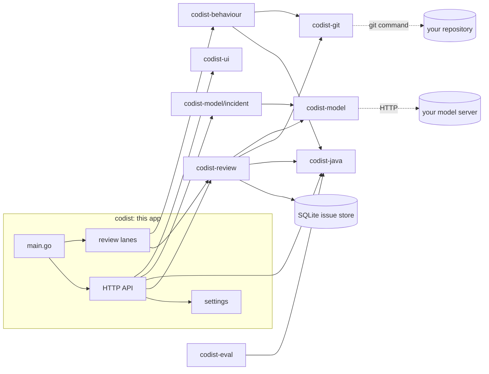

# How Codist fits together

Codist is one program built from eight repositories. This app wires them together; each of the others is a Go
module it imports, so the result is still a single file with no runtime to install.

## The repositories

| Repository | Holds | Depends on |
|---|---|---|
| **codist** | `main.go`, settings (`internal/config`), the HTTP API and the review lanes (`internal/app`) | all below |
| **codist-review** | reviewing one commit, checking model claims, following issues across commits, the first-run baseline; `store/` keeps reviews, issues and incidents in SQLite; `risk/` ranks commits; `activity/` holds the work lanes, keeps and streams the log and records model calls | java, git, model |
| **codist-fix** | preparing a fix with the model, building and testing it in a separate copy, committing only its files after a person approves | git, model, review |
| **codist-behaviour** | running the methods a commit changed before and after it with a fixed Java harness, building with Maven or javac | java, git |
| **codist-java** | the Java parser (pure-Go tree-sitter), 19 code checks and 3 habit checks, types and Spring facts, the class graph, the call graph, the Repository page numbers | none |
| **codist-git** | commits, changed lines, files at any commit, blame and branches through the git command; `testrepo/` builds a sample repository for tests | none |
| **codist-model** | the model server client; `incident/` reads production logs and analyses incidents | none |
| **codist-ui** | the Svelte interface; its built `dist/` is committed and embedded | none |
| **codist-eval** | the benchmark and the behaviour-difference experiment | java, git, model, review |

The arrows only point one way: the modules never import the app, and `codist-model` reaches the project's code
through an interface (`incident.Code`) instead of importing the parser or git.

## What happens when Codist runs

1. **Start**: read settings, open the SQLite store, ask the model server whether it has the model.
2. **Index**: read every Java file and build file (pom.xml, application.yml) at HEAD into types, routes, modules and
   links. It is rebuilt when HEAD changes, or when you look at another branch.
3. **Baseline**, the first time only: run the code checks on the whole code and credit each issue to the commit that
   last changed its line.
4. **Three lanes** work through the commits, newest first (the third only when turned on):
   - the **check lane** runs the exact code checks, milliseconds a commit, and never waits for the model;
   - the **model lane** asks the model about each changed file of recent commits (the last 50 by default).
   - the **behaviour lane**, only when turned on, builds each recent commit and its parent and runs the changed
     methods on both with the same inputs.
   A new commit goes to the front of each. A restart picks up whatever was not finished.
5. **Each model claim is checked** before it is stored, in three steps:
   - it must quote code near the line it names, or it is dropped;
   - exact facts settle what they can: a null claim needs a value that is dereferenced, "strings compared with ==" is
     checked by the type-aware check on that line, and "not implemented" is checked against the commit's other files
     (the model also sees those files' changes);
   - a serious claim that survives gets a second look, and stays an alarm only when the model quotes code that proves
     it. Anything contradicted or unproven is kept as a note, with the reason.
6. **Issues are followed** by a key of rule or title, file and the flagged line, so a later commit that removes the
   problem closes the issue.
7. **The page** reads everything through the JSON API, compressed with gzip, and gets live updates through server
   events. The Activity page reads each lane's queue, the recorded model calls and a live stream of the log.
8. **A fix** is prepared only when a person asks: the model writes small edits to the current code, Codist builds and
   tests them in a separate copy, and commits only the fix's files when the person approves. The new commit is then
   reviewed like any other, which closes the issue.

## Where data lives

Everything is in `~/.codist/<repo>-<hash>.db` (or `CODIST_DATA_DIR`): reviews, findings, issues and incidents. Nothing is
sent anywhere except to the model server you chose.

## Building one file

`make build` builds with `-tags 'grammar_subset grammar_subset_java'`, which keeps only the Java grammar in the
parser, and `CGO_ENABLED=0`, since both the parser and SQLite are pure Go. The interface comes already built inside
`codist-ui`, so neither Node nor a C compiler is needed.
