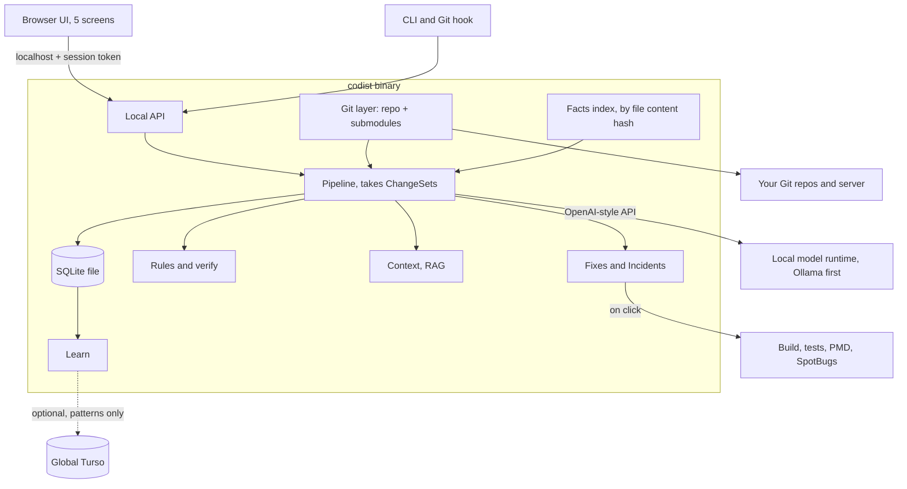
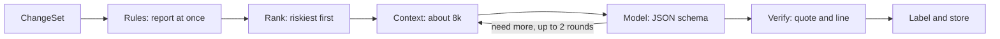
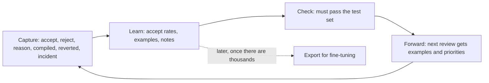

# Rebuild plan

Rebuild Codist as one private loop for Java teams: review a change, show the evidence, prepare a fix, approve or reject, and learn from that. Code owns the facts, the model owns the judgement, and a person owns every change.

The evidence is in the [research report](../research/rebuild-research.md). Sizes in this plan are estimates, and every model and technique is a candidate until the test set confirms it.

## Status

| Milestone | Work | Finished when | Status |
|---|---|---|---|
| 0. Branch and harness | `rebuild` branch, CI on macOS and Windows, reproducible results, per-call timing, logged drops, switches for rules, RAG, facts and filters | A test run can be repeated and explained on both systems | Done |
| 1. Test set | 199 real bugs from Defects4J and GitBug-Java, a false-alarm set from fixed versions, a frozen holdout, a sample submodule repo. Run the 16 GB models and report 32 GB | `qwen2.5-coder:14b` has a full result, with confidence ranges | In progress: bug set built, rules measured, model runs and sample repo still to do |
| 2. Core engine | Git layer with submodules, ChangeSet, facts by content hash, rules, SQLite store, CLI, secure server | Rule results from the CLI match or beat today on both systems | |
| 3. Model and RAG | Method-level review, schema output, context builder, "need" loop, one experiment at a time | Each kept technique has a paired win on the test set | |
| 4. Fixes and Proven | Patch-only fixes, compile and test on click, before-and-after tests, the three labels | First fix success rate and Proven precision are published | |
| 5. Review UI | Review, Knowledge and Activity screens, keyboard map | The whole loop works in the browser | Started early: new menu, and Review shows one highlighted diff with issues inline, using the original colours |
| 6. Graph and Incidents | Four-level graph and Incidents screen, with a test set for incidents | A stack trace leads to a prepared fix, and accuracy is measured | Started: the four zoom buttons work in the browser. Method level shows the members of changed classes, without method-to-method call lines yet. Incidents not started |
| 7. Git depth | Branch comparison, conflict resolution, merge checks, other Git actions | Merge cases in the test set are scored | |
| 8. Learning loop | Capture, learn, check and forward, team notes in `.codist/` | Learned changes beat the unlearned version on the holdout | |
| 9. Global patterns | Turso over HTTP, read-only download and local copy, draft-and-approve sending, holding table and review tool | A pattern sent from one install helps a review on another with a different model, and a network capture shows no code left | |
| 10. Open-source release | Licence, where rules and patterns came from, installers, real Windows testing, new docs | Someone else can install it, and every claim has a published result | |

### Results from milestone 0

| Run | Bugs found | Logic bugs | Notes |
|---|---|---|---|
| Rules only, macOS and Windows | 10/16 (39–82%) | 1/7 (3–51%) | Same score on both systems |
| `qwen2.5-coder:7b`, macOS | 11/16 (44–86%) | 2/7 (8–64%) | 327 s, 17 calls, about 19 s per call, 15 findings dropped |

The earlier harness recorded 12/16 for `7b`. The new drop log explains the difference: the model did report the `last-copy-race` bug, and the filter removed it as "repeats a rule finding" because an unrelated rule fired next to it. That filter matches by position, not topic, and is due for replacement in milestone 3. Ranges are 95% confidence, so these results can't be told apart statistically.

### Results on real bugs and with the model alone

| Run | Result | Notes |
|---|---|---|
| Rules only, 118 real bugs | 6 located (2–11%), an upper bound | 2 of 120 bugs could not run: one patch didn't apply and one repository is gone. Candidate false alarms on 10 of 118 fixes |
| `qwen2.5-coder:7b` alone on the 16 seeded bugs, rules and filters off | 5/16 (14–56%), 1/7 logic, 12 noise | 804 s, about 35 s per call |

Rules score 10/16 on the seeded project and at most 6/118 on real bugs. The seeded project was written alongside those rules, so **its scores greatly overstate what the rules catch**. The model hasn't been run on the real bugs yet, and "located" counts a finding near the bug even if it doesn't describe it.

## Decisions

| Topic | Decision |
|---|---|
| Principles | Local and private, prepare-and-approve, Java first, single binary. Rules tune the model and never replace it |
| Hardware | Design for 16 GB and also report a 32 GB result |
| Systems | macOS and Windows required. Testing on a real Windows machine comes later |
| Keep | Code graph with microservice, service, layer and method views. Incidents. Branch analysis |
| Git | Submodules, several developers, pull requests and direct commits, conflicts, merges and other Git actions |
| Data | A local SQLite file for everything private. A global Turso database only for bug patterns |
| Project | Open source. The licence choice is deferred |
| Out for now | Release |
| Stays out | Sign-off, fix all branches, AI developer summaries, issue stages, Hubs shape, issue graph, anything that rates people |

## Architecture

| Idea | What it does |
|---|---|
| ChangeSet | A commit, range, staged change, merge result, submodule bump or incident's suspect commits all use one pipeline |
| Facts by content hash | Each parsed file is saved under its Git content hash, so any commit or merged result uses the right code and only changed files are re-parsed |
| Repo set | One root repo plus its submodules, each with its own index and history, linked by Feign clients and routes |
| Rules first | Rules report on every file straight away, and model reviews follow in a queue |

## Model

The review unit becomes one changed method. Code chooses what gets reviewed and checks what comes back, and the model makes every judgement in between.

| Memory | Models to test | Evidence so far |
|---|---|---|
| 16 GB (design target) | `qwen2.5-coder:14b` (current default), `qwen2.5-coder:7b` (baseline), `qwen3.5:9b`, `gemma4:12b` | `7b` scored 12 of 16. `14b` has no full result. The others are untested on Java review |
| 32 GB (also reported) | `qwen3.8:27b`, `qwen3.6:27b` | Published scores are for other tasks and settings |

A sceptical second call that can delete findings stays out. It removed every model finding in Codist's own test. Retest it only as a rank or a label.

## RAG and context

RAG stays small, with no vector database. A retrieval test with no model decides whether embeddings are ever added.

| Source | How | Tokens (start) |
|---|---|---|
| Changed method and diff | From the parser, with class fields and annotations | about 2,300 |
| Code facts | Callers, callees, routes, tests, transaction and auth facts, tagged confirmed or possible | about 800 |
| Guidelines and global patterns | BM25 over the local copy, searched from the changed method, top 3 | about 450 |
| Team standards | Matching sections of `AGENTS.md`, `CLAUDE.md` and `.codist/` | about 300 |
| Learned examples | Accepted and rejected findings for this kind of code | about 200 |
| History | Last 3 commits touching the method | about 150 |

## What 99% means

No tool reaches 99% on all bugs. Top cloud tools sit around 67–81% precision and 48–60% recall (third-party snapshot, October 2026). So 99% applies only where code can prove a finding.

| Label | Meaning | Target |
|---|---|---|
| Proven | An exact rule match, or a test that passes before the change and fails after | 99% of these are real. Claiming it needs about 300 in a row with none wrong |
| Likely | A model finding plus supporting facts from code | Measured and published, no promise |
| Suspicion | Model only | Shown as a question, not a verdict |

Nothing can guarantee finding every bug. The plan covers every bug class on purpose, measures each one, and publishes the gaps: null and error handling, injection and secrets, resource leaks, Spring transactions, access control, concurrency, performance, service contract drift, clean merges that break, configuration and migrations, and logic bugs.

## Several developers and Git

| Situation | What Codist does |
|---|---|
| Two people commit | Reviews each commit against its parent, then compares the work. Same lines: warns before the merge. Different lines: uses the call graph to find clean merges that could break. Same bug: shown once |
| Conflict | Predicted without touching files. The model prepares a resolution from the base, both sides and both messages. Code compiles and tests it on click, and you approve it |
| Merge | Reviews only what the merge added, and compiles the merged result |
| Pull request or direct commit | Both work, using local Git branches, with no GitHub or GitLab login |
| Submodule bump | Reviews that submodule's commits between the old and new pointer. A missing submodule shows as "not reviewed" |
| Rebase, cherry-pick | Recognises the same change and doesn't review it twice |
| Force-push | Findings stay attached to the code line, not the commit ID |
| Revert | Counts against the reverted fix in the learning loop |
| Large pull | Rules run on everything, and model time goes to the riskiest methods first |

Developers share knowledge through committed `.codist/` files. Shared review history and activity aren't planned, and a SQLite file on a network drive isn't safe to share.

## Feedback and forward loop

The model's weights don't change from everyday use. What it receives does.

## Global patterns

Local SQLite holds findings, decisions, activity and learning, and none of it leaves the machine. A global Turso database holds only general bug patterns, and each install keeps a local copy.

| Topic | Plan |
|---|---|
| A pattern contains | Bug class, framework, a general description, a made-up code example, how to detect and fix it, and a licence. Never project names, paths, class names or real code |
| Sending | Off by default. Codist drafts the pattern, shows exactly what would be sent, and sends it only on approval |
| Publishing | A sent pattern waits in a holding table until a maintainer reviews it and it passes the test set |
| Tokens | The app ships a read-only token, because anything in open-source code is public. A per-table insert token may allow sending. Not tested yet |
| Driver | `go-libsql` has no Windows build, `libsql-client-go` is deprecated and `turso-go` is archived, so Codist would use Turso's documented HTTP API. Not tested yet |
| Limits | Everyone's reads count against the project's account, so installs fetch only changes, rarely, and keep working from the local copy if Turso is down or blocked |
| Offline | Patterns ship in the binary as a starting set, and air-gapped sites install a pattern file by hand |

## UI

Svelte 5 with grouped lists, system fonts and keyboard-first review.

| Screen | Contents |
|---|---|
| Review | Changes list, one scrolling diff with findings inline, evidence panel, patch sheet with compile and test results, branch and conflict warnings |
| Graph | Zoom from microservice to service, layer and method. What a change touches is marked at each level. Levels are built in the browser for now, and move to the server if large repos need it |
| Incidents | Stack trace, affected code and services, suspect commits, prepared fix |
| Knowledge | Rules, team standards, what Codist has learned, and accept rates |
| Activity | Exactly what the model saw and said, with secrets masked, stored only on this machine |

## Safety

| Risk | Plan |
|---|---|
| Open network port | Localhost by default, done. Session token in milestone 2 |
| Running a teammate's code | Builds and tests run only on click and show which commit will run. Limits apply where the OS allows them, and Windows is harder |
| Instructions hidden in code | Code is treated as data, code checks the facts, and the model can never apply anything |
| Bad learning | `.codist/` changes appear in review, and learned changes must pass the test set |
| Poisoned global patterns | Only reviewed patterns publish, and they can add or explain findings but never suppress one |
| Private details in patterns | Nothing is sent without approval, and every send is checked. Published data can't be fully recalled |
| Secrets | Masked before saving, with a retention limit on the Activity log |
| Hidden network calls | A written network policy and a test that runs with the network off |

## Publishing this wiki

`docs/wiki` is the source. `python3 scripts/publish_wiki.py` copies it to the GitHub wiki, once a first page has been saved there in the browser.
